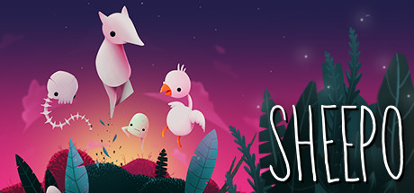

**Redz Hub is a Roblox script hub offering game-specific exploits and universal utility scripts for Roblox games.**

---

## 📖 About

Redz Hub is a Roblox script hub offering game-specific exploits and universal utility scripts for Roblox games. Known for its clean UI and fast loading times.

## ⚠️ Problems Without Redz Hub

| Problem | Status |
|---------|--------|
| PC only | ✅ Fixed |
| Requires executor like Wave or Fluxus | ✅ Fixed |
| Game-specific modules updated regularly | ✅ Fixed |

## ✅ Solution

**Redz Hub v2.6** addresses all of these limitations with a feature-complete solution for **Roblox (PC)**.

## 🎯 Features

- Auto-farm modules
- ESP / Wallhack
- Speed and fly
- Teleport to players
- Noclip
- Infinite jump
- Kill aura
- Auto-collect items
- Anti-ban measures
- Game-specific scripts

## 🚀 Installation

1. Get a compatible Roblox executor (Level 7+)
2. Join any Roblox game
3. Open your executor and paste the loadstring from the button above
4. Execute the script
5. The **Redz Hub** GUI will open in-game

## 💎 Free vs Pro

| Feature | Free | Pro |
|---------|------|-----|
| Core Modules | ✅ | ✅ |
| All Features | ✅ | ✅ |
| Priority Updates | ❌ | ✅ |
| Premium Support | ❌ | ✅ |
| Cloud Config Sync | ❌ | ✅ |

## 💻 Requirements

- Windows 10 / 11 (64-bit)
- Roblox (PC)
- 4 GB RAM minimum (8 GB recommended)
- .NET Framework 4.8+

## 🍎 macOS / Linux

## ⚖️ Legal

For educational and personal use only. Use responsibly and in accordance with the platform's terms of service.

---

